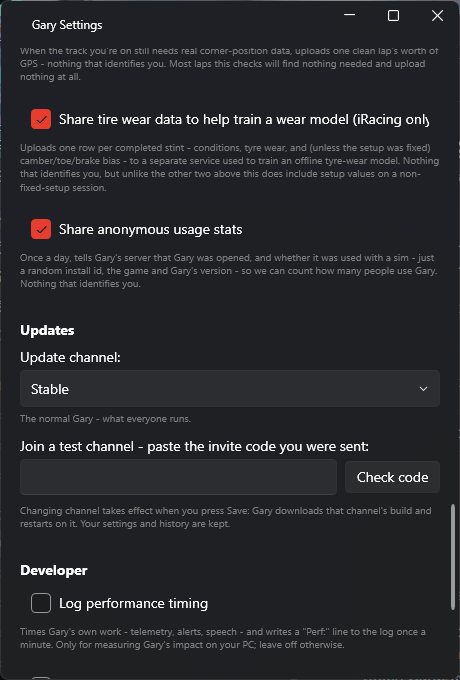
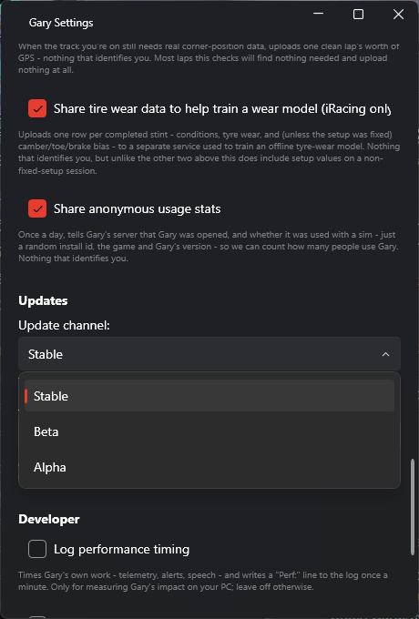
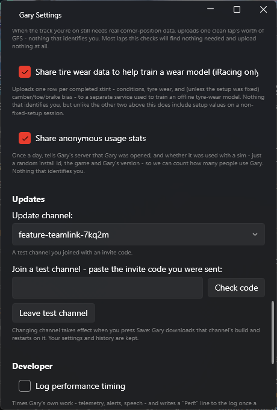

# Install

1. Download **`Gary-win-Setup.exe`** from [the latest release](https://github.com/dgutierrez1287/gary-releases/releases/latest).
2. Run it.

That's it. No admin rights needed — it installs to your user account. You don't need to
install .NET or anything else first; everything is bundled.

{: .warning }
**Windows will warn you.** You'll get *"Windows protected your PC"* — click **More info**,
then **Run anyway**. This happens because the installer isn't code-signed, and a signing
certificate costs a few hundred dollars a year for a project that isn't making any money.
Nothing is wrong; it just means Microsoft doesn't know who built it.

## Language

Gary speaks and understands **English**, whatever language your Windows is in. To understand
you he needs Windows' English speech recognition: if he tells you he can't find it, add English
in **Windows Settings → Time & language → Speech** (or **Language & region**), then restart him.

## Updates

Automatic. Gary checks when you start him and every 2 hours while he's running, and downloads
new versions quietly in the background. When one is ready, a banner drops down at the top of his
window:

- **Update now** restarts Gary on the new version straight away.
- **Remind me later** hides the banner for 2 hours.

Ignore it and the update installs next time you start Gary. He never restarts himself
mid-session — the one exception is finishing a voice download (see [Voices](first-run.html#voices)),
which needs a restart to take effect and tells you before it happens.

### Update channels

Gary updates from a **channel**. Everyone starts on **Stable**. To get builds earlier, pick
another one in **Settings → Updates**:

| Channel | What you get |
|---|---|
| **Stable** | The normal Gary - what everyone runs |
| **Beta** | Fixes and features a little early. Usually solid |
| **Alpha** | Every test build. Changes often, and may break |

Pick a channel and press **Save**. Gary asks to confirm, downloads that channel's build (about
175 MB) and restarts on it. From then on he updates only from that channel. Your settings and
history are kept, and you can switch back the same way at any time - going back to Stable can
mean going back a version, which is fine.

**Test channels.** Big new features are sometimes tested on their own channel before they reach
everyone. They aren't in the list - you join one with an **invite code**, posted in the
**#test-releases** channel on the [Discord](https://discord.gg/XAdbGx8zV8). Paste the code under
*Join a test channel*, press **Check code**, then **Save**. **Leave test channel** takes you back
to where you were. When a test ends, Gary moves you back on his own.

## Uninstall

Windows **Settings → Apps → Installed apps → Gary**. That removes the program. Your settings,
logs and history stay in `%AppData%\Gary` — delete that folder too if you want it all gone. See
[Where Gary keeps things](troubleshooting.html#where-gary-keeps-things) for what's in there.

## Next

**[First run →](first-run.html)** Get push-to-talk mapped and Gary talking.
