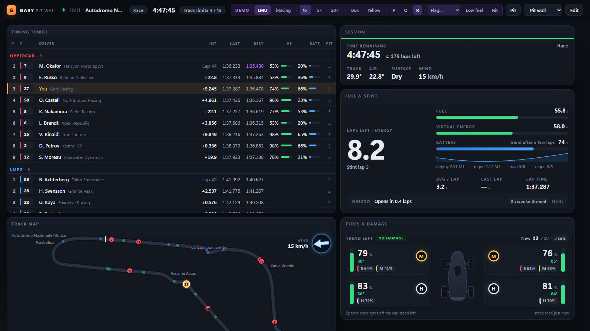

# Pit wall

A live dashboard for a second monitor, a tablet or a phone, showing what Gary sees. It's built
from widgets you arrange yourself, and it runs in a web browser, so there's nothing else to
install.

## Opening it

- **On this PC:** press **Pit wall** in Gary's main window.
- **On a tablet, a phone or another PC:** open the address shown under the button (*"Pit wall on a
  tablet or phone: http://…"*) in that device's browser. It needs to be on the same network as
  your sim PC.

Gary has to be open for the pit wall to show anything. It updates on its own as you drive.

## The widgets

| Widget | What it shows |
|---|---|
| **Timing tower** | Your class or the whole field: positions, intervals, last and best laps, pit stops. Pick the columns in the widget's settings (⚙); only columns the sim can fill are offered. iRacing adds iRating and licence; LMU adds the other cars' Virtual Energy and battery |
| **Relative** | The cars around you on the road, with the gap in time, a class badge (GTP, Hypercar, GT3, or the make in a one-make series), and whether they're a lap up or down |
| **Track map** | Every car on the track, with a wind arrow and wind speed. On a track Gary has no map for, he draws one from your first clean lap. It has no corner names, but you get a map |
| **Session** | Time or laps left, the estimated laps left in a timed race or qualifying, track and air temperature, the surface, the wind, and your incident points against the limit (iRacing) |
| **Fuel & stint** | Fuel (and Virtual Energy in LMU), laps left, average use, the pit window and whether to box. LMU Hypercars also get the battery and which way it's trending |
| **Tyres & damage** | **LMU.** Tread left, temperature and compound for each wheel, new sets left and used spares, plus punctures, lost wheels, suspension and body damage drawn on the car |
| **Telemetry** | Gear and speed, throttle and brake traces with ABS shown on the brake the way iRacing does it, and steering. The gear flashes at the shift point. Shrink it as small as you like and everything still fits |

A widget the current sim can't feed (tyres in iRacing) is hidden while you drive that sim and
comes back when you switch.

## Things that pop up

Some things only show when they matter:

- **Flags.** A slim banner at the top and a coloured frame round the whole screen. Yellow, blue,
  white, the meatball, a penalty (which stays up until it's served), and green, but only at the
  start and on a restart.
- **Your pit stop.** A card showing what the stop will do: fuel, tyres, repairs. In LMU it
  appears when you request a stop and shows whether each corner gets new or used tyres. Otherwise
  it appears in the last third of the lap when a stop is due, and stays through the stop.
- **BOX THIS LAP.** When the fuel is critical, it covers the session box in the second half of the
  lap and tells you whether your box is early, in the middle or late in the pit lane.

## Arranging it

Press **Edit**. Then:

- **+ Add widget** adds one. Drag a widget by its header to move it, and drag its corner to
  resize it. **✕** removes it, and **⚙** opens its settings where it has any.
- **Every sim and session gets its own layout.** In edit mode, pick the sim and the session at the
  top. If you're in a session, it starts on that one. If you pick a sim or session you're not in,
  a demo race fills the widgets so you can see what you're arranging. A sim or session you haven't
  set up uses the screen's default layout.
- **Screens.** *Pit wall* and *Tablet* come built in, and each device remembers which one it
  shows. **Save as…** copies the current screen under a new name, and **Delete** removes it (or
  puts a built-in screen back to how it started).

Press **Done** when you're finished. Layouts are kept by Gary on your PC, so every device sees the
same screens.

## Trying it without driving

Add `?demo` to the end of the address (`…/pitwall/?demo`) for a simulated race. Controls in the
top bar switch between LMU and iRacing and between practice, qualifying and the race, speed it
up, and set off a pit stop, a yellow, a flag, low fuel or damage.

{: .note }
The pit wall is new. If a widget shows something odd, post a screenshot in the
[Discord](https://discord.gg/XAdbGx8zV8).

## Next

**[Voice commands →](voice-commands.html)**
